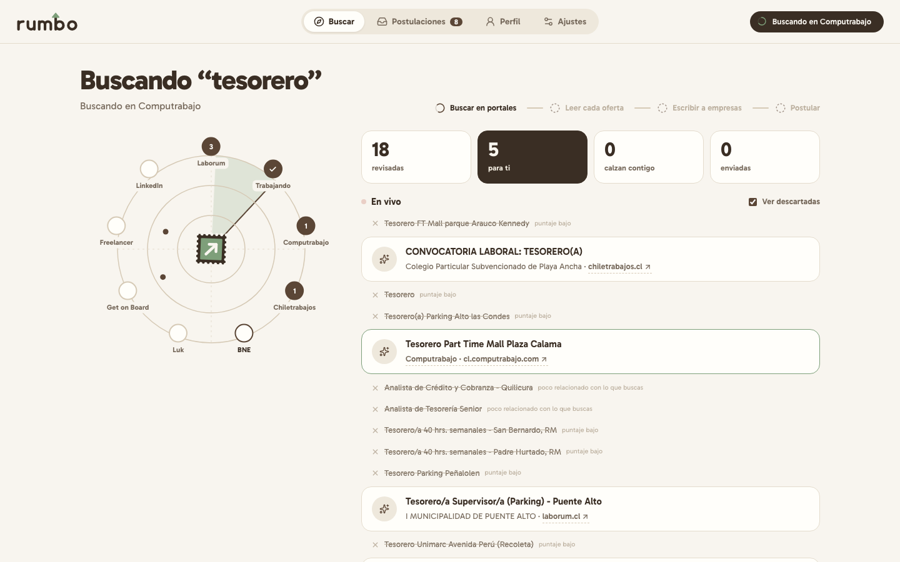
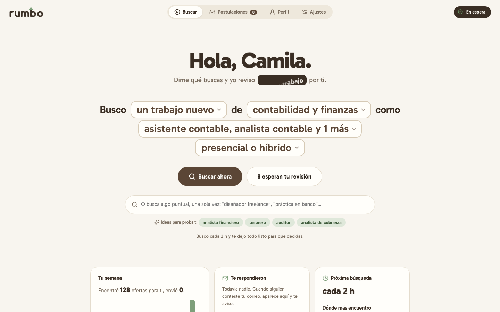
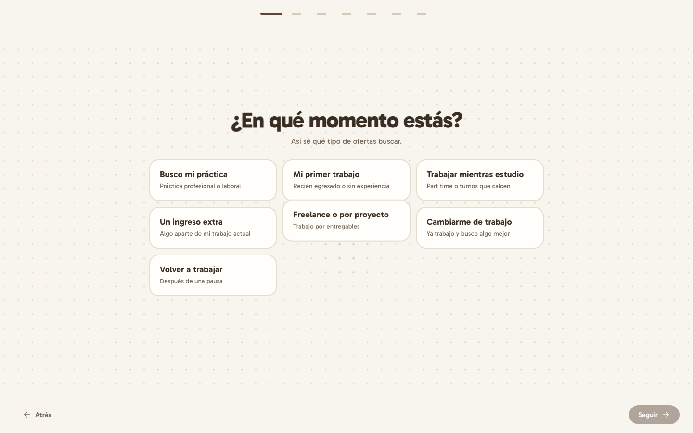
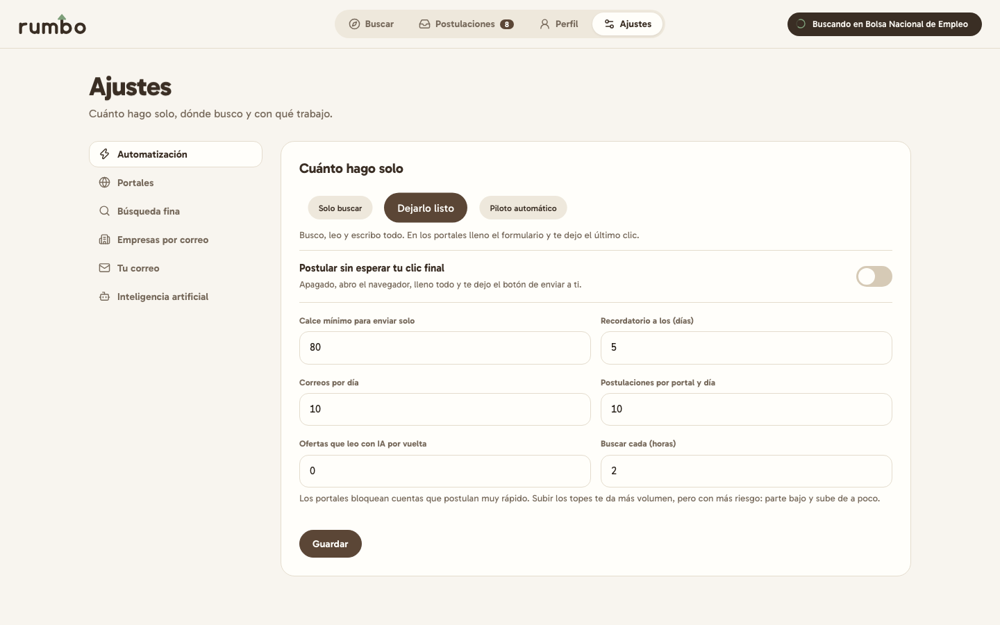
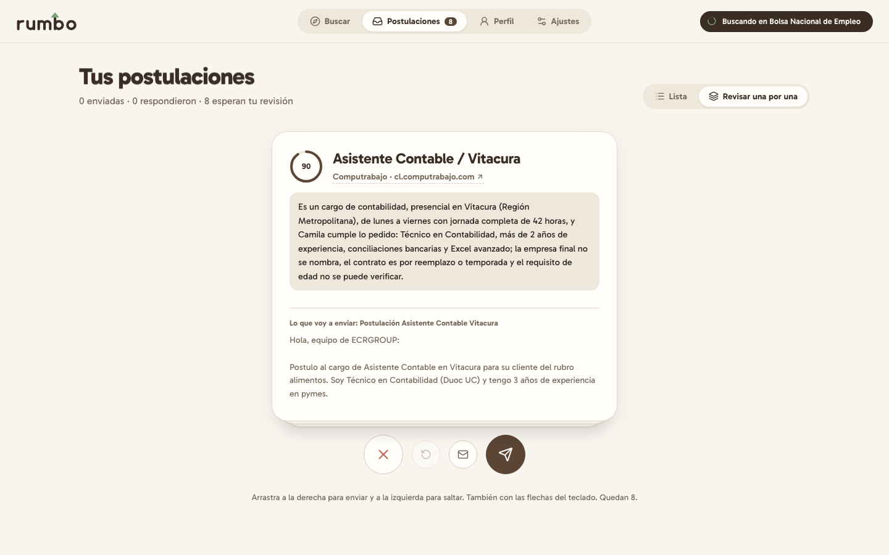
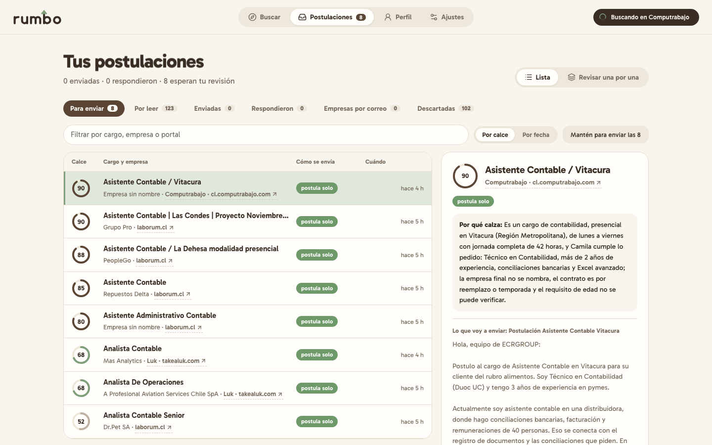
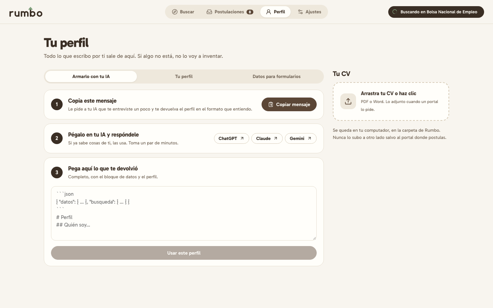

<p align="center"></p>
<p align="center"><b>Tu búsqueda de trabajo en piloto automático.</b><br>
Busca en los portales de empleo de Chile y Latinoamérica, evalúa cada oferta con IA según tu perfil,
redacta tus postulaciones y postula por ti. Para cualquier profesión.</p>

<p align="center">
  <a href="docs/INSTALACION.md">Instalación</a> ·
  <a href="docs/GUIA.md">Guía de uso</a> ·
  <a href="docs/COMO-FUNCIONA.md">Cómo funciona</a> ·
  <a href="CONTRIBUIR.md">Contribuir</a>
</p>



## Qué hace

- **Busca por ti** cada pocas horas en **Laborum, Trabajando.com, Computrabajo, Chiletrabajos, la Bolsa
  Nacional de Empleo, Luk (Buk), Empleos Públicos, Firstjob, Yapo, Get on Board, Freelancer y LinkedIn**
  (opcional: Indeed vía JobSpy).
- **Sirve para cualquier trabajo:** vendedor, contadora, enfermero, diseñadora o desarrollador. Le dices
  qué buscas, en qué modalidad (remoto, híbrido o presencial), qué jornada y en qué región.
- **Filtra lo que no te sirve** antes de gastar IA: ofertas engañosas, idiomas que no hablas o palabras
  que tú excluyes.
- **Evalúa con IA cada oferta contra tu perfil:** le pone un *fit* de 0 a 100, explica por qué y redacta
  una postulación con tu experiencia real. Nunca inventa nada que no esté en tu perfil.
- **Postula solo** en los portales que lo permiten, con un navegador real y tu sesión. Puede dejarte el
  clic final a ti.
- **Consigue clientes por correo** si trabajas por tu cuenta: la IA busca pymes, startups o agencias con
  su correo publicado y les escribe un correo humano, uno por uno.
- **Hace el seguimiento:** recordatorio a los N días y aviso cuando alguien te responde.
- **Lo ves trabajar en vivo:** un radar con cada portal, la lista de lo que va encontrando (con enlace a la
  página original), lo que descarta y por qué, y cómo lee y puntúa cada oferta.
- **Arma tu búsqueda con clics:** "Busco *mi práctica* de *marketing* como *community manager*, *remoto*".
  Situación, rubro y cargos sugeridos, sin escribir consultas.
- **Tu perfil con la IA que ya usas:** copias un mensaje, lo pegas en ChatGPT, Claude o Gemini y pegas de
  vuelta la respuesta. Rumbo arma tu perfil y tu búsqueda con eso.
- **Postula a todo lo que calza de una vez** (desliza para confirmar) o **revísalas una por una**
  deslizando tarjetas: derecha para enviar, izquierda para saltar.

LinkedIn, Indeed y Yapo son **solo para encontrar**: Rumbo no postula ni escribe ahí. La única
excepción es opcional y viene apagada: postular en LinkedIn con "Solicitud sencilla"
(`envio.linkedin_auto`), con riesgo alto de que LinkedIn restrinja tu cuenta (ver
[Cómo funciona](docs/COMO-FUNCIONA.md#uso-responsable)).

| | |
|---|---|
|  |  |
|  |  |
|  |  |

## Instalación rápida

Requiere **Python 3.10 o superior**. Funciona en macOS, Windows y Linux.

```bash
pipx install "rumbo[todo] @ git+https://github.com/vizzeuk/rumbo"   # o: pip install ...
playwright install chromium        # solo para postular en portales
rumbo                               # abre http://localhost:8765
```

La primera vez aparece una bienvenida por clics: en qué momento estás, tu rubro, los cargos, cómo quieres
trabajar, tu perfil y cuánto quieres que haga solo. Al terminar ves tu primera búsqueda en vivo. Guía completa, incluida la instalación desde el código: [docs/INSTALACION.md](docs/INSTALACION.md).

## La IA: sin API key si tienes Claude Code

Por defecto Rumbo usa la **CLI de Claude Code con tu sesión** (no necesitas API key). También funciona
con la **API de Anthropic**, cualquier **API compatible con OpenAI** (OpenAI, OpenRouter, Groq...) u
**Ollama gratis en tu propio PC**. Se cambia en Ajustes.

## Tus datos son tuyos

Todo vive en tu computador, en `~/.rumbo` (o en la carpeta de la variable `RUMBO_HOME`): la base de
datos, tu perfil, las sesiones del navegador y las capturas de cada postulación. La contraseña del
correo se guarda en el llavero del sistema. Rumbo no tiene servidor propio ni recolecta nada.

## Uso responsable

La postulación automática usa un navegador con **tu** cuenta. Algunos portales prohíben herramientas
automatizadas en sus términos y pueden suspender cuentas. Rumbo trae topes diarios, pausas entre
postulaciones y un modo que deja el clic final para ti. Postular a todo no sirve; postular bien, sí.
Más detalle en [docs/COMO-FUNCIONA.md](docs/COMO-FUNCIONA.md#uso-responsable).

## Créditos

- [React Bits](https://reactbits.dev) (MIT + Commons Clause) para las animaciones de la interfaz.
- [Bencho](https://bencho.dev) (bloques gratuitos, MIT): deslizar para confirmar, interruptores y avisos.
- [chambaflow](https://github.com/IsrraDex36/chambaflow) (MIT): flujo de postulación en Computrabajo.
- [JobSpy](https://github.com/speedyapply/JobSpy) (MIT): búsqueda opcional en Indeed.

Ver [NOTICE](NOTICE). Código bajo licencia [MIT](LICENSE). Diseño: [docs/BRAND.md](docs/BRAND.md).
