# Guía de uso

## Primer uso: la bienvenida
Todo por clics, una pregunta por pantalla:
1. **En qué momento estás:** práctica, primer trabajo, trabajar mientras estudias, ingreso extra,
   freelance, cambiarte de trabajo o volver a trabajar.
2. **Tu rubro:** tecnología, diseño, marketing, ventas, contabilidad, salud, educación y más.
3. **Los cargos:** Rumbo te sugiere cargos de tu rubro (puedes agregar otros). De ahí salen las
   búsquedas que escribe en cada portal, ajustadas a tu momento (por ejemplo "práctica contador").
4. **Cómo quieres trabajar:** remoto, híbrido o presencial, y la región.
5. **Tu perfil:** con la IA que ya usas (recomendado) o rápido, con tu nombre, correo y unas líneas de
   experiencia. Aquí también puedes subir tu CV.
6. **Cuánto hace solo:** solo buscar, dejarlo todo listo para tu clic final, o piloto automático.

Al terminar ves tu primera búsqueda en vivo.

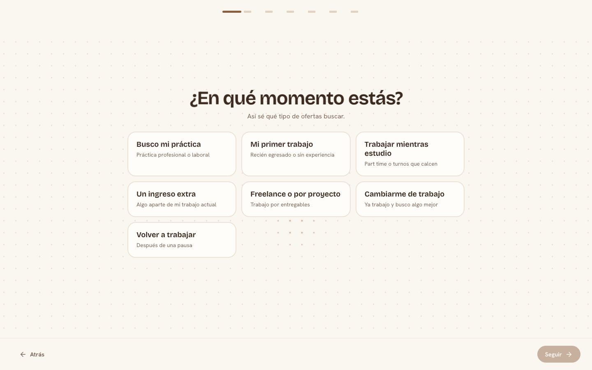

## Para que haga todo solo
En **Buscar** aparece una lista con lo que falta: conectar una IA, subir tu CV, conectar tu correo y entrar
a un portal. Cada paso te lleva directo al lugar donde se hace y la lista desaparece cuando está todo listo.

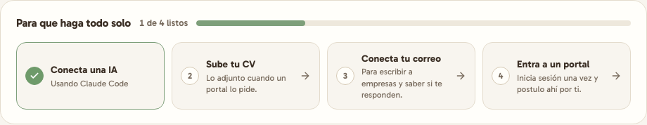

## Conectar la IA
En **Ajustes → Inteligencia artificial**:
1. Elige un proveedor. Cada uno dice cuánto cuesta: hay varios **gratis** (OpenCode Zen, OpenRouter, Gemini,
   Groq u Ollama en tu propio PC) y Claude Code usa tu sesión sin clave.
2. Pega tu clave. La (i) explica dónde sacarla y el botón "Sacar clave" abre el sitio.
3. Elige el modelo de la lista (sin escribirlo a mano). "Solo gratis" deja a la vista los que no cobran.
4. Toca **Conectar y probar**: le hago una pregunta corta y te digo si funcionó y cuánto tardó, o qué falló.

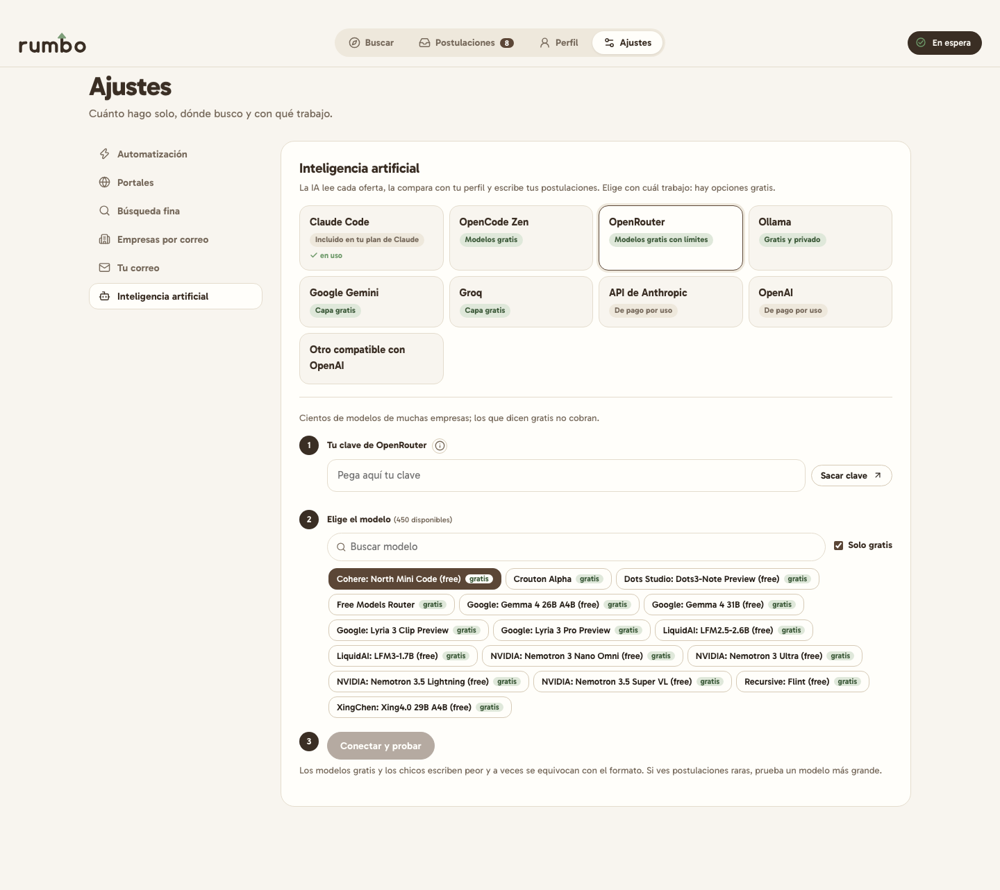

Los modelos gratis y los chicos escriben peor que los grandes. Si las postulaciones salen raras, prueba otro.

## Conectar tu correo
En **Ajustes → Tu correo**, la (i) junto a "Contraseña de aplicación" tiene el paso a paso para Gmail y
Outlook. No es tu contraseña normal: es una clave aparte que puedes borrar cuando quieras.

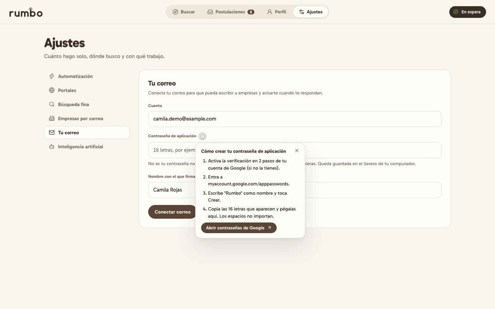

## Entrar a los portales
En **Ajustes → Portales**, los que dicen "postula solo" tienen un botón **Iniciar sesión para postular**. Se
abre el portal, entras con tu cuenta y cierras la ventana. Te aviso si la sesión quedó lista.

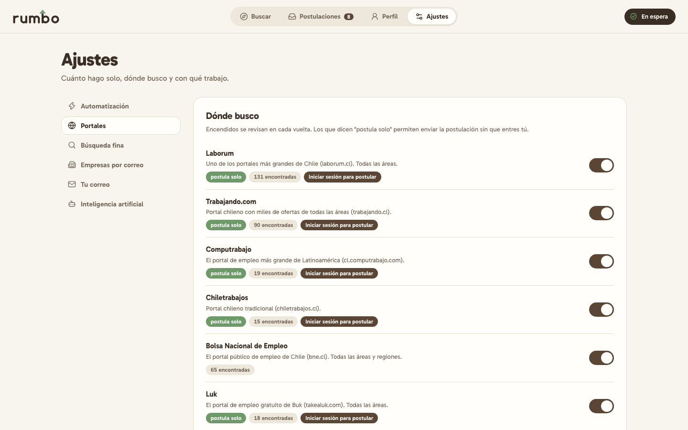

## Tu perfil con la IA que ya usas
En **Perfil → Armarlo con tu IA**:
1. Copia el mensaje.
2. Pégalo en ChatGPT, Claude o Gemini y respóndele lo que te pregunte (si ya te conoce, usa eso).
3. Pega aquí la respuesta completa. Rumbo guarda tu perfil, tus datos de contacto y tu búsqueda.

## Las pantallas
- **Buscar:** tu búsqueda en una frase ("Busco *un ingreso extra* de *tecnología* como *desarrollador*,
  *remoto*"). Toca cada parte para cambiarla. Con **Buscar ahora** ves el radar: cada portal se ilumina
  mientras lo reviso, y a la derecha aparece en vivo lo que encuentro, con enlace a la página original,
  lo que descarto y por qué, y el calce de cada oferta cuando la leo. Al final puedes **deslizar para
  postular** a todas las que calzan o revisarlas una por una.
  Debajo tienes una **búsqueda puntual** ("tesorero", "práctica en banco") que busca eso una sola vez sin
  cambiar tu búsqueda guardada, ideas de cargos para probar, tu semana, quién te respondió, lo que necesita
  tu atención y cuándo es la próxima búsqueda.
- **Postulaciones:** una tabla por etapa (para enviar, por leer, enviadas, respondieron, empresas por correo,
  descartadas), ordenada por calce o por fecha. Al lado ves la vista previa con por qué calza y el texto que
  voy a enviar. "Mantén para enviar" las manda todas. En **Revisar una por una** las ves como tarjetas:
  derecha para enviar, izquierda para saltar (también con las flechas del teclado).
  - **No mostrar esta empresa:** desde la vista previa; nunca más verás sus ofertas (se deshace en Ajustes →
    Búsqueda fina).
  - **Exportar:** descarga todas tus postulaciones en una planilla (CSV que abre Excel o Google Sheets).
- **Perfil:** tu perfil, tus datos para formularios y tu CV.
- **Ajustes:** cuánto hace solo y los topes diarios, qué portales revisa, la búsqueda fina, empresas a
  las que escribir por correo, tu correo y la IA.

Arriba a la derecha, la isla oscura te dice qué estoy haciendo en este momento.

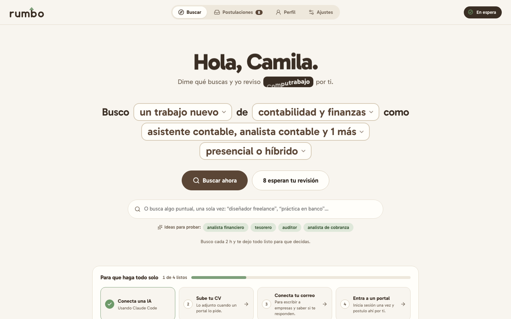
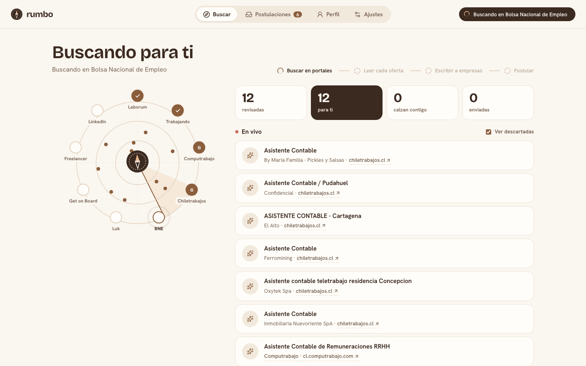
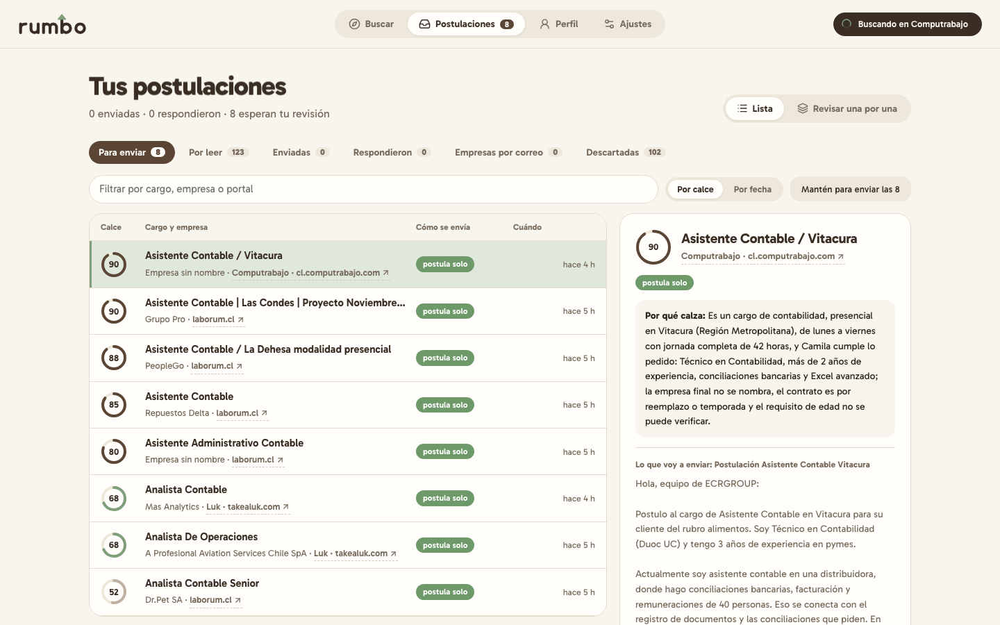
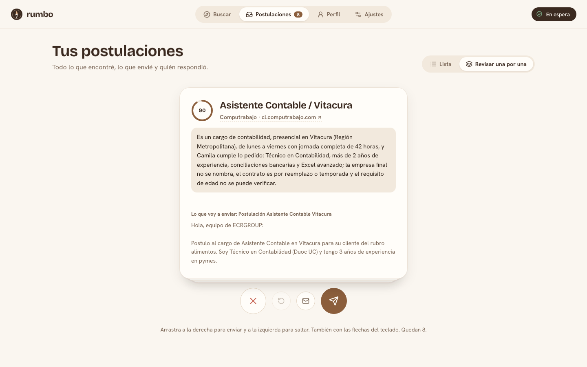

## El fit
Un número de 0 a 100 que la IA calcula comparando la oferta con tu perfil y con lo que buscas
(modalidad, jornada, horario, región). Bajo 40 la oferta se descarta sola; puedes verlas con el filtro
"Descartadas".

## Enviar postulaciones
Según la oferta, en el detalle verás uno de estos botones:
- **Enviar por correo:** si la oferta o la empresa tiene correo.
- **Postular en <portal>:** abre el navegador con tu sesión y completa el formulario.
- **Copiar y abrir:** copia la postulación y abre la oferta para que la pegues tú.
- **Ver la oferta y postular yo:** en fuentes que son solo para encontrar.

## Modo automático
En **Ajustes → Automatización** (piloto automático). Encendido, en cada búsqueda Rumbo:
- envía los correos con fit igual o mayor al umbral, hasta el tope diario;
- postula en los portales donde iniciaste sesión, hasta el tope por portal;
- manda un recordatorio a quien no respondió en N días;
- revisa tu correo y mueve a "Respondieron" lo que tenga respuesta.

**Postular a todo lo que calza:** al terminar una búsqueda, desliza el botón para postular a todas las
listas de una vez. Respeta los topes diarios de Ajustes; si quieres más volumen, súbelos de a poco (los
portales bloquean cuentas que postulan demasiado rápido).

Recomendación: parte con el modo apagado, revisa las primeras postulaciones y ajusta tu perfil. Después
enciéndelo con un umbral alto (75 a 80) y topes bajos (10 a 20 por día).

## Escribir un buen perfil
- Una línea de quién eres, tus estudios e idiomas reales.
- Experiencia con logros concretos (cifras, herramientas, responsabilidades).
- Qué buscas y qué no, con la mayor precisión posible.
- Si ofreces servicios, una sección "Cómo presentarme" con lo que ofreces y cómo quieres sonar.
- Si algo es confidencial (el nombre de tu empresa actual, por ejemplo), escríbelo como indicación:
  "No nombrar a mi empleador actual".

## En el celular
La interfaz se adapta al celular: las pestañas quedan abajo, los menús salen como hojas desde abajo y los
botones son grandes. Hoy Rumbo corre en tu computador y escucha solo ahí (`localhost`), así que en el
celular lo ves si lo abres en ese mismo equipo o lo publicas tú en un servidor.

| | | |
|---|---|---|
| 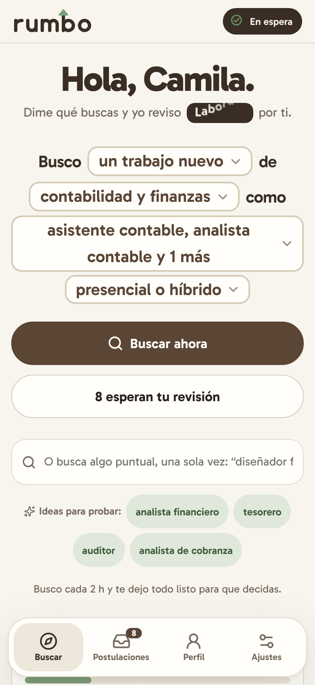 | 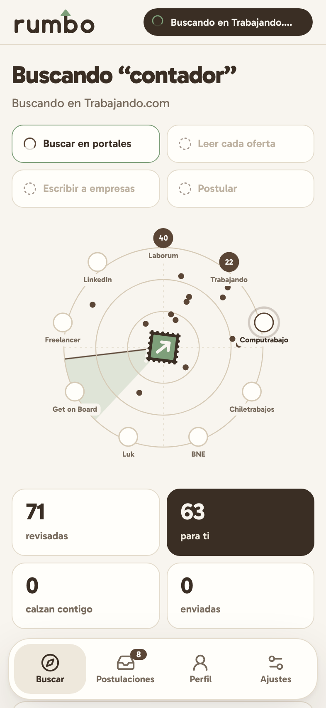 | 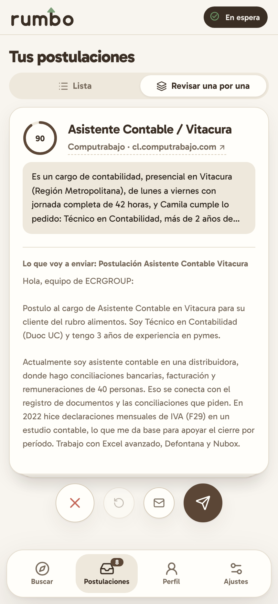 |
